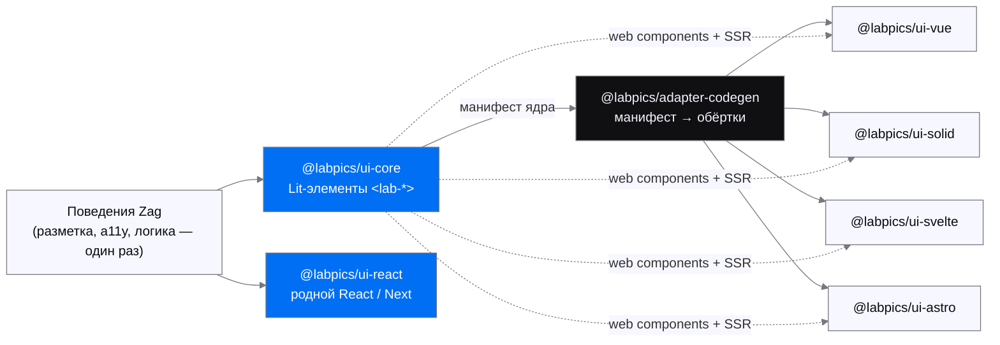
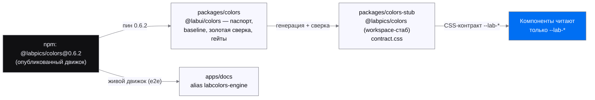

# LabUI

> Кросс-стек дизайн-система Labpics: одна родная реализация компонентов,
> пять стеков потребления, цвет и иконки — внешние ядра, а не копии.

Компоненты LabUI читают **только семантические CSS-токены `--lab-*`** — имена
переменных и есть контракт. Размеры rem-относительные, типографика плавная
(Geist, `clamp()`), материалы поверхностей переключаются осью `data-material`
(`solid` / `glass` / `acrylic`), тени и высоты — генерируемая лестница.
Цвет (`@labpics/colors`), иконки (`@labpics/icons`) и JS-моушн (`@labpics/motion`) —
внешние пакеты: LabUI их потребляет и не дублирует.

## Как это устроено (ADR-0001, «A-prime»)

Родная реализация каждого компонента ровно одна: поведения
[Zag](https://zagjs.com), обёрнутые двумя рендерерами — Lit-элементом `<lab-*>`
в ядре и родным React-рендерером (без Lit в React-пути). Vue / Solid / Svelte /
Astro компоненты не переписывают: они **потребляют** web-components ядра через
обёртки, которые `@labpics/adapter-codegen` генерирует из единого манифеста,
выведенного из исходников ядра, — поэтому API адаптеров не может разойтись с
Lit/React-версиями.



Ядро закрывает **27 компонентов** (`packages/core/src/components/*`, без
служебного `field`); у каждого адаптера — сгенерированная обёртка под все 27.
Подробности — [docs/adapters.md](docs/adapters.md), решение —
[docs/adr/0001-cross-stack-base.md](docs/adr/0001-cross-stack-base.md).

## Пакеты

Все пакеты воркспейса — `private` (версия `0.0.0`, у стабов `colors-stub` /
`icons` — `0.0.0-stub.0`): до релиз-главы ничего не публикуется. Крест-ссылка
ведёт на README пакета, где он есть.

| Путь | Пакет | Назначение |
| --- | --- | --- |
| `packages/tokens` | `@labpics/ui-tokens` | Генератор + сгенерированные токены: отступы, радиусы, z-index, плавная типографика (`clamp()`), веса, штрихи, фокус-кольцо, доли стейт-оверлеев `--lab-state-hover/pressed` ([README](packages/tokens/README.md)) |
| `packages/core` | `@labpics/ui-core` | Кросс-стек ядро: Lit base-элемент + шов поведений Zag, контракт темы/материала, Lit SSR shim. Общее для Lit-рендерера (4 стека) и родного React |
| `packages/shadow` | `@labpics/ui-shadow` | Генератор лестницы теней `--lab-shadow-{xs,s,m,l,xl}` и семантических высот `--lab-elevation-{resting,raised,overlay,modal}` ([README](packages/shadow/README.md)) |
| `packages/materials` | `@labpics/ui-materials` | Ось режима материала (`data-material` = solid\|glass\|blur\|acrylic) над контрактом `--lab-*`: α-гарантия границы, specular rim, детерминированные деградации ([README](packages/materials/README.md)) |
| `packages/fonts` | `@labpics/fonts` | Self-host Geist и Geist Mono (вариативные woff2, OFL 1.1). Опциональный пакет ([README](packages/fonts/README.md)) |
| `packages/colors` | `@labui/colors` | labui-сторона цветового движка: паспорт бренда (`labui.config.json`), генерация baseline, золотая сверка со стабом через опубликованный `@labpics/colors`, CI-гейты пар и стейт-оверлеев ([README](packages/colors/README.md)) |
| `packages/colors-stub` | `@labpics/colors` | ВРЕМЕННЫЙ стаб CSS-контракта `--lab-*` в воркспейсе; тает по мере того, как движок забирает роли (см. ниже) ([README](packages/colors-stub/README.md)) |
| `packages/icons` | `@labpics/icons` | ВРЕМЕННЫЙ стаб-мост к внешнему ядру иконок (пока не опубликовано) ([README](packages/icons/README.md)) |
| `packages/react` | `@labpics/ui-react` | Родной React / Next рендерер (те же поведения Zag, без Lit в React-пути; ADR-0001) |
| `packages/vue` | `@labpics/ui-vue` | Vue-адаптер над Lit web-components + SSR ([README](packages/vue/README.md)) |
| `packages/solid` | `@labpics/ui-solid` | Solid-адаптер над Lit web-components + SSR ([README](packages/solid/README.md)) |
| `packages/svelte` | `@labpics/ui-svelte` | Svelte 5-адаптер над Lit web-components + SSR ([README](packages/svelte/README.md)) |
| `packages/astro` | `@labpics/ui-astro` | Astro-интеграция над Lit web-components + SSR (ручной Lit SSR-рецепт: `@astrojs/lit` устарел на Astro 5) ([README](packages/astro/README.md)) |
| `packages/adapter-codegen` | `@labpics/adapter-codegen` | Приватный dev-инструмент: генерирует обёртки адаптеров из манифеста ядра ([README](packages/adapter-codegen/README.md)) |
| `apps/docs` | `@labpics/ui-docs` | Сайт документации + Playwright smoke/e2e-фикстуры |

## Внешние ядра: цвет, иконки, моушн

LabUI **потребляет** эти ядра, а не реализует их. Шов — CSS-переменные `--lab-*`
(имена переменных = контракт, их нельзя менять; словарь ролей —
[docs/vocabulary.md](docs/vocabulary.md)).

- **Цвет — `@labpics/colors`.** Движок **опубликован в npm**; labui пинит `0.6.2`
  (зависимость [`packages/colors/package.json`](packages/colors/package.json),
  alias `labcolors-engine` в [`apps/docs/package.json`](apps/docs/package.json)).
  Потребление тремя каналами — см. схему ниже. Полная карта шва и план снятия
  стаба — [`INTEGRATION.md`](INTEGRATION.md) и
  [`docs/external-deps/lab-colors.md`](docs/external-deps/lab-colors.md).
- **Иконки — `@labpics/icons`.** Реальный пакет (`Labpics-Team/lab-icons`, 444 SVG
  Filled + Outline, tree-shakeable ESM, `currentColor`) пока **не опубликован**
  (`private: true`, без тегов/релизов) — это блокер на том репозитории, не на
  LabUI. `packages/icons` — тонкий build-free стаб-мост, чтобы резолвился
  import-спецификатор ([`docs/external-deps/lab-icons.md`](docs/external-deps/lab-icons.md)).
- **Моушн — `@labpics/motion`.** Внешний пакет; компонент потянет его, когда
  понадобится JS-управляемая анимация. Сейчас ни один пакет воркспейса на него
  не завязан.



## Инструментарий

| Область | Выбор | Почему |
| --- | --- | --- |
| Менеджер пакетов | **pnpm** workspaces | Контент-адресуемый стор, протокол `workspace:`, строгий hoisting |
| Сборка | **tsup** (esbuild) | Zero-config двойной ESM+CJS+`.d.ts` на пакет — размер под библиотеки |
| Линт + формат | **Biome** | Один быстрый бинарник (без плагинной чехарды ESLint/Prettier), детерминированный CI |
| Типы | **TypeScript** strict | `tsconfig.base.json`, цель ES2022 |
| Версионирование | **Changesets** | Semver и changelog на пакет; релиз — позже |
| E2E / визуал | **Playwright** | Smoke + компонентный e2e (`pnpm test:e2e`) |

## Разработка

```bash
pnpm install          # установить воркспейс
pnpm -r build         # собрать каждый пакет
pnpm -r typecheck     # строгий typecheck по воркспейсу
pnpm lint             # Biome lint
pnpm format           # Biome format (запись)
pnpm test:e2e         # Playwright smoke (в первый прогон ставит браузеры)
```

Требования: Node `>=20`, pnpm `>=9` (см. `package.json#engines`; закреплён
`packageManager` = pnpm 10).

## Контрибьютинг

- **Только PR в `main`.** Прямые пуши отклоняются; CI (lint + typecheck + build +
  Playwright) должен быть зелёным до мержа. Никаких `--no-verify`, `--force`.
- **Conventional Commits** (`feat:`, `fix:`, `chore:`, `docs:`, `test:`, …).
- Изменение пакета требует Changeset: `pnpm changeset`.

## Лицензия

`UNLICENSED` до первой публикации (см. `package.json`). До релиз-главы публикаций
нет. Исключение — `@labpics/fonts`: шрифты Geist под OFL 1.1
(см. `packages/fonts/OFL.txt`).
