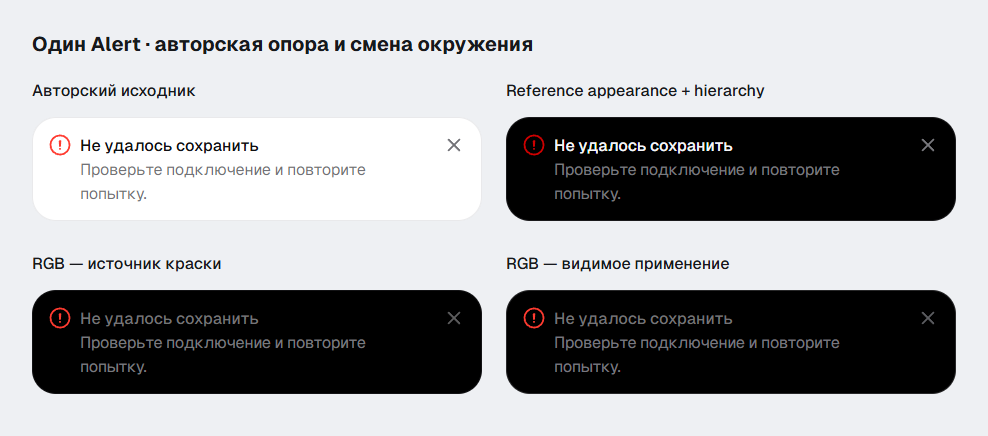
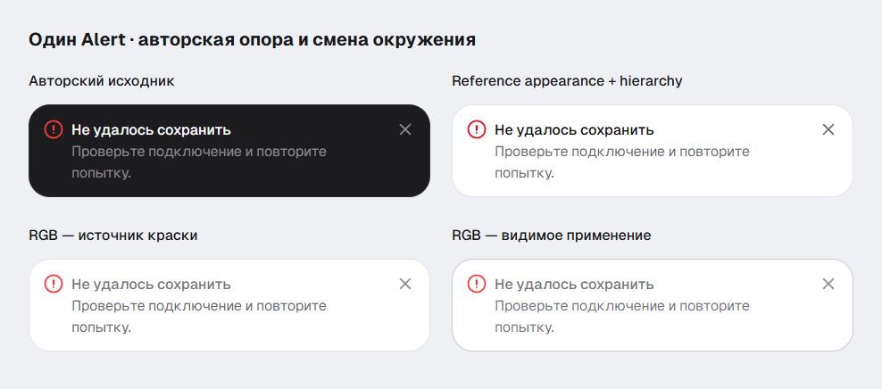

# Reference appearance на настоящем Alert

Новый контракт сохраняет авторские raw RGB + alpha в исходном окружении и
силу heading при смене полярности. Это квалификационный опыт на локальном
Colors из PR [#895](https://github.com/Labpics-Team/lab-colors/pull/895),
не перевод production LabUI с `@labpics/colors@1.0.3`.

## Что проверено

Vite собрал настоящий `<lab-alert>` из LabUI `798b68fb` и настоящий Rust WASM.
Все четыре Alert имеют ширину 450 px, одинаковые содержание, геометрию,
типографику и материал Solid Elevated. Сохранены авторская колонка и прежние
`source` / `visible` comparators; их состояния и raw outputs в 16 совпадающих
случаях совпали с [опытом на публичном Colors 1.2.0](../colors-v3-20261122/public-1.2.0-report.json).

Четвёртая колонка использует:

- `colorTarget(rawRgb, { referenceAppearance: occurrence })` для каждой из
  шести частей Alert, сохраняя alpha исходного paint;
- `assignment(..., { reference: [[surfacePort, authoredBackground]] })`;
- `preserveTonalHierarchy([headingOccurrence, descriptionOccurrence])`.

Авторский фон берётся из `materials.tiers[components.alert.material].solidRole`:
`bg-grouped-secondary`, то есть `[255,255,255]` в light и `[28,28,30]` в dark.
Он не меняется при наблюдении нового окружения. Heading и description имеют
одно и то же требование WCAG text. Клиент не вычисляет контраст, тон, новые
пороги или адаптированные RGB.

Проверены 11 реальных рендеров: light nominal/black/blue/gray/recovered,
dark nominal/white/blue/gray/recovered и возврат темы dark → light. Дополнительно
проверен authoring API: исходный orange `[255,128,0,.5]` на синем фоне имеет
нейтральный reference visible `[128,128,128]`, но при смене фона сохраняет
оранжевый source identity и alpha, а после возврата — исходный raw RGB.

## Результат

| Состояние reference | Heading: raw RGB, CR | Description: visible RGB, CR | Иерархия | Результат |
|---|---|---|---|---|
| light nominal | `[16,16,18]`, 19,0065 | `[114,114,119]`, 4,7849 | 3,9722 | ready / exact |
| light → black | `[245,246,249]`, 19,4327 | `[120,121,126]`, 4,8348 | 4,0193 ≥ 3,9722 | ready / unfinished |
| dark nominal | `[246,248,250]`, 15,9825 | `[135,135,142]`, 4,7693 | 3,3511 | ready / exact |
| dark → white | `[16,17,18]`, 18,9028 | `[103,103,108]`, 5,6250 | 3,3605 ≥ 3,3511 | ready / unfinished |
| blue `[40,60,100]`, обе темы | — | — | — | incomplete / limit |
| gray `[128,128,128]`, обе темы | — | — | — | unsatisfied |

CR и отношения взяты из typed evidence Colors, не из клиентской формулы.
`referenceSelections()` и одноимённое поле `assessmentReport()` совпали.
В nominal все шесть raw RGBA равны авторскому профилю; во всех принятых
обновлениях alpha сохранена. Геометрия и типографика пяти видимых частей
совпали с авторской колонкой во всех 11 состояниях. Реальный keyboard focus
close получил вычисленный outline. Полный accepted state, CSS краски и
подложка сохранены при отказах; recovery и theme return не дают дрейфа.




Это заметно исправляет прежнее сведение primary к минимуму контраста.
При этом `ready / unfinished` не обещает оптимальный выбор: dark → white
получился сильнее исходной композиции. Blue не дал пригодного нового
состояния в пределах solver limit; gray не имеет принятого решения с
сохранённой alpha. Эти состояния не объявлены успешно адаптированными.

В сохранённом прогоне вызов нового reference graph занял 99,0 ms для
light → black и 74,7 ms для dark → white; blue — 21,6–23,5 ms до `incomplete`.
Nominal/recovered — 0–0,9 ms. Это один функциональный Windows/headless Chrome
прогон, не performance benchmark и не оптимизированный release artifact.
Поле `updateMs` включает также два прежних сравнительных solver: 313,7 ms
для light → black нельзя приписывать одной новой reference-колонке.

## Границы

Проверен верхний Solid Elevated без стека. Групповая прозрачность нижних слоёв
Alert, пространственные Acrylic/Glass, Cleanliness, native и доставка
публичного нового Colors остаются вне этого опыта. Production dependencies,
lockfile, профиль LabUI и Figma не изменены. Shared Colors tree только читался;
его сборка и файлы не изменялись.

## Артефакт и повторение

Colors source: `95be02f7f0a99ef0cad282bdffa6ff9283fa2eeb`, подготовленный локально
WASM `release --no-opt`. Точные runtime/type hashes и хеши потребительского
bundle записаны в [report.json](report.json). WASM SHA-256:
`a335ff473d759917a9fc00431531b87ed2d74e67cf5dcd8f7faa77f0a042d8e9`.
Проверена неизменность байтов до и после прогона. Browser: Chrome
`157.0.8103.51`, headless, без NVDA и видимых окон.

В исходной ветке lockfile не учитывает добавленный `@labpics/icons@0.4.0`.
Для локальной установки использован уже подготовленный npm tarball Icons
SHA-256 `d4962b817d19431393131f0aebb5d70f745e103e4062a6003a52926a8362c3bb`
через временный pnpm override. `package.json` и lockfile восстановлены
побайтно после установки. Собран только dist этого отдельного worktree:

```powershell
pnpm --filter @labpics/ui-core... build
$env:COLORS_PROBE_COLORS = 'D:/AgentWork/.scratch/labui-reference-colors-95be02f7-20261123'
$env:COLORS_PROBE_PROVENANCE = 'development-only lab-colors 95be02f7; local release --no-opt; not published'
$env:COLORS_PROBE_BROWSER = 'C:/Program Files/Google/Chrome/Application/chrome.exe'
$env:COLORS_PROBE_OUTPUT = 'docs/evidence/colors-reference-20261123'
node apps/docs/tests/alert-colors-reference.mjs
```

`COLORS_PROBE_COLORS` указывает на отдельный неизменяемый снимок подготовленного
пакета. Его JS и WASM должны происходить из одной сборки. Без явного пути
скрипт не запускается. `failures: []` означает успешную проверку описанных
свойств, включая честное сохранение предыдущего результата при отказе.

Источники: [контракт builder](https://github.com/Labpics-Team/lab-colors/blob/95be02f7f0a99ef0cad282bdffa6ff9283fa2eeb/packages/colors/program-wire/abi-v3.d.ts),
[authoring lowering](https://github.com/Labpics-Team/lab-colors/blob/95be02f7f0a99ef0cad282bdffa6ff9283fa2eeb/packages/colors/authoring-graph.js),
[W3C source-over](https://www.w3.org/TR/compositing-1/#simplealphacompositing).
