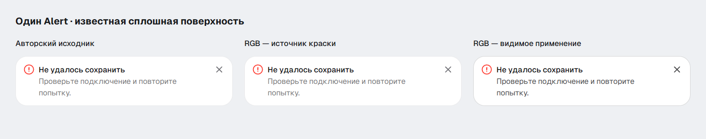
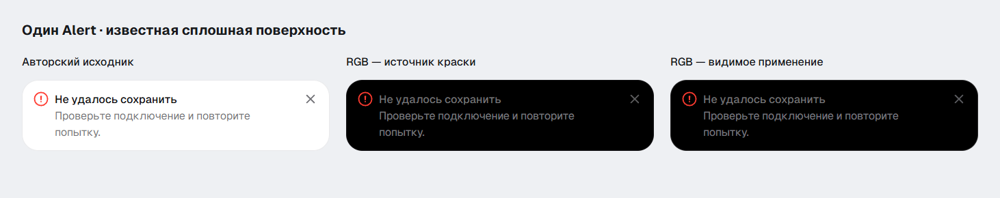
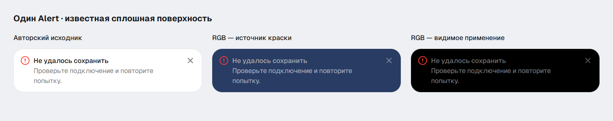
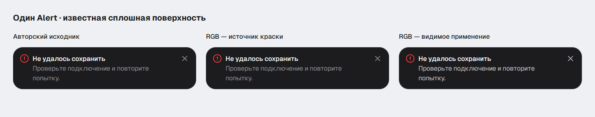

# Colors V3 в настоящем Alert

Этот опыт выявляет недостающий контракт адаптации. Он **не переводит production
LabUI на V3** и не объявляет готовой адаптацию композиции или Cleanliness.
Figma `LuaiBd4anRi4DMZayKAnY2` не изменялась.

## Проверенный путь

Vite собирает существующий `<lab-alert>` и настоящий Rust WASM. Профиль
`components.alert.roles` порождает шесть независимых применений: heading,
description, dangerIcon, close, border, focus. Одинаковый RGB не объединяет
применения. Heading и description имеют одинаковое требование WCAG text;
для close/focus выбран WCAG UI, для dangerIcon — graphic. Отдельных порогов,
тональных формул и подмены secondary на primary здесь нет.

Две колонки используют один граф с разным смыслом опоры:

- `source`: `colorTarget(id, authoredRgb)`. Опора относится к исходной краске;
  авторская opacity сохраняется.
- `visible`: `colorTarget(id, authoredRgb, {appearance: occurrence})`.
  Эта намеренно проверяемая трактовка ошибочна для исходного RGB прозрачной
  краски: опора теперь относится к конечному видимому результату.

Третья колонка показывает неизменённый авторский Alert. Его материал — Solid
Elevated. У вычисляемых колонок фактическая solid-заливка и цвета частей
публикуются только вместе после `ready`. Отказ оставляет прежнюю заливку и
части. Focus каждого close проверяется настоящим DOM-focus, затем снимается
перед снимком. Все снимки — headless Chromium, без видимых окон и звука.

## Результат

Восемь состояний: light nominal/black/blue/recovered и dark
nominal/white/blue/recovered. [Отчёт](report.json) содержит raw outputs,
computed styles существующего компонента, состояние решения, время обновления,
проверенный WASM SHA-256 и версию браузера.

- `source` сохраняет авторский nominal в обеих темах.
- `visible` меняет прозрачные description/border уже на исходной поверхности.
  Например, light description `[60,60,67,.722]` превращается в
  `[0,0,3,.722]`. Это ошибка выбора смысла опоры потребителем.
- На чёрной подложке `source` даёт heading `[116,116,118,1]` и description
  `[166,167,175,.722]`: видимая цветовая иерархия практически исчезает.
  Шрифтовой вес остаётся авторским. `ready` не доказывает сохранение всей
  композиции. Общего отношения силы двух применений в данном V3 нет.
- Для light blue `[40,60,100]` режим `visible` возвращает `incomplete`;
  настоящий Alert сохраняет предыдущее принятое чёрное состояние. Возврат
  к nominal восстанавливает результат в обоих режимах и темах.






Одна сплошная поверхность не покрывает стек Elevated/Base/Muted: у нижних
слоёв Alert есть групповая прозрачность. Пространственный Acrylic/Glass,
group opacity и общий контекстный механизм качества остаются обязательной
частью дальнейшей интеграции. Их нельзя заменить этим опытом.

## Происхождение и повторение

Проверен локальный development-artifact из
[`64fb1dc5b058e5af10fdb7aee57d60b757725503`](https://github.com/Labpics-Team/lab-colors/commit/64fb1dc5b058e5af10fdb7aee57d60b757725503),
а не опубликованный V3. Его WASM SHA-256:
`bfa970bc12a9c4c9f1275af0b10b9c153bdc1ef76d0df0d675939135f22b3105`.
Production зависимости и lockfile этим опытом не меняются.

23 ноября тот же Alert проверен с точным npm tarball `@labpics/colors@1.2.0`,
source `4a3e99cb63a6db122171f6dc920ec67e5da0b99c`. Его WASM SHA-256:
`7d135a74bf5a26f027d48ed8d674880d97ad825d12f1514d496be35f4adacf08`.
[Публичный отчёт](public-1.2.0-report.json) содержит восемь новых рендеров;
raw colors, состояния решения и computed styles обеих колонок совпали
с исходным опытом во всех случаях. Опубликованный артефакт воспроизводит
выявленную потерю иерархии; версия пакета сама по себе её не устраняет.

После обычной подготовки зависимостей LabUI и сборки
`pnpm --filter @labpics/ui-core... build`, из корня репозитория:

```powershell
$env:COLORS_PROBE_COLORS = 'D:/AgentWork/colors-product-goal-20261122/packages/colors'
$env:COLORS_PROBE_PROVENANCE = 'development-only local lab-colors 64fb1dc; not a published coordinate'
$env:COLORS_PROBE_BROWSER = 'C:/Program Files/Google/Chrome/Application/chrome.exe'
node apps/docs/tests/alert-colors-v3.mjs
```

`COLORS_PROBE_COLORS` явно направляет только сборку опыта на заданный каталог
публичного Colors-пакета. Без него используется установленная зависимость,
которая должна поддерживать V3. Без `COLORS_PROBE_BROWSER` запускается
установленный headless Chromium Playwright. Новые результаты появляются в
`packages/colors/artifacts/alert-v3`; `COLORS_PROBE_OUTPUT` меняет каталог.
Успешное завершение команды означает выполнение опыта и восстановления,
а не принятие цветовой политики.

Независимое ревью уточнило проверку восстановления: nominal и recovered обязаны
иметь `ready`, принятое состояние и все шесть ролей Alert с конечными RGBA.
Одного равенства двух пустых outputs недостаточно. Сохранённый отчёт из восьми
реальных рендеров прошёл усиленную проверку; четыре различающих случая
(полный отказ, отсутствие принятого состояния, отсутствующая роль, NaN)
завершились ошибкой. Неизменённый браузерный рендер повторно не запускался.

`LabThemeState.update` экспортирует исключения в Swift через
`@Throws(Exception::class)`, как и вызываемый host: отказ возвращается приложению,
а не завершает процесс. [Реальный Swift consumer](https://github.com/Labpics-Team/labui/actions/runs/45077495154)
прошёл отдельный XCTest на iPhone 16 Pro / iOS 18.5 simulator: Swift host
возвращает `NSError`, прямой `try await state.update` сохраняет предыдущие
colors/preferences/context, затем принимает следующий context и восстанавливается.
Выполнен один тест, без ошибок; это проверка границы Swift/Kotlin, не скорости
устройства и не готовности V3. Собран настоящий статический consumer framework.
Исходный запуск остановился до теста на неверном типе XcodeGen target;
исправлен `bundle.unit-test`, UI-test target сохранён.

Граф: [alert-composition-v3.mjs](../../../packages/colors/test/alert-composition-v3.mjs).
Потребитель: [fixture](../../../apps/docs/src/_fixtures/alert-colors-v3.mjs).
Сборка и проверка: [alert-colors-v3.mjs](../../../apps/docs/tests/alert-colors-v3.mjs).

Источники: [публичный V3 builder](https://github.com/Labpics-Team/lab-colors/blob/64fb1dc5b058e5af10fdb7aee57d60b757725503/packages/colors/program-wire/abi-v3.d.ts),
[его lowering для role.on](https://github.com/Labpics-Team/lab-colors/blob/64fb1dc5b058e5af10fdb7aee57d60b757725503/packages/colors/authoring-graph.js),
[W3C source-over](https://www.w3.org/TR/compositing-1/#simplealphacompositing),
[Kotlin/Swift: передача ошибок](https://kotlinlang.org/docs/native-objc-interop.html#errors-and-exceptions).
