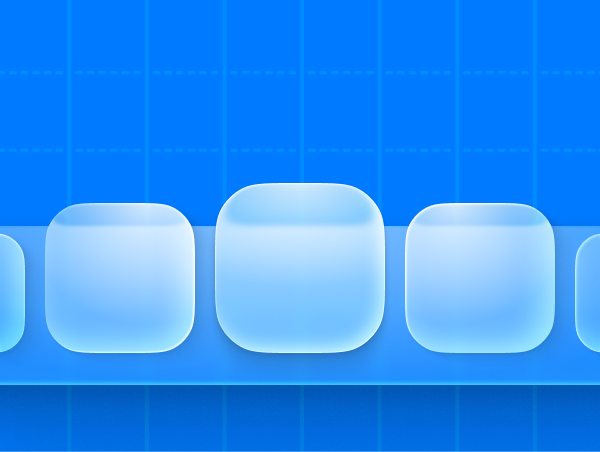
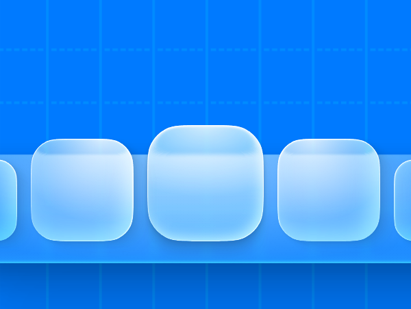

# Floating Dock: контур, свет и граница результата

Прочитан неизменённый Figma `LuaiBd4anRi4DMZayKAnY2`, узел `7671:9049`.
Пять Glass-фигур и подложка имеют `cornerSmoothing=0.6`. Runtime теперь использует
один контур из дуг и кубических переходов для линзы, clip, rim, тени и Card.
Кеш сохраняет геометрию; scroll/transform не пересобирают поле.

Сцена 600×452 воспроизведена по исходным gradients, inner/drop shadows и
vector paths PATTERN. Ошибка внешнего фона — 0.0447 по каналам RGB 0…255.
Это диагностическая композиция исходных paints над production runtime;
она не является общим импортёром Figma и не меняет рецепты обычных материалов.

| Опыт | Центральная фигура MAE | Правая | Левая |
|---|---:|---:|---:|
| Circular contour + SVG Soft Light | 4.117 | 2.480 | 2.785 |
| Figma mask + SVG Soft Light | 4.096 | 2.469 | 2.768 |
| Общий production contour + белый Pegtop Soft Light | 1.344 | 2.214 | 2.337 |
| Полные bounds внутренних теней, прежняя оптика | 1.203 | 1.226 | 1.222 |
| Принятый профиль оптики с ограничением depth | 1.171 | 1.227 | 1.223 |

Среднее считается внутри прежней круговой области, отступив 2px от границы;
оно сравнимо между опытами, но не оценивает весь сглаженный край.
Первичные параметры — [dock-optics.json](dock-optics.json); текущее сравнение
с полосами у контура — [уточнение оптики](glass-optics-refinement.md).

Основная широкая потеря света оказалась в белом Soft Light. Для белого source
Figma ближе к `2b−b²`, чем к SVG/W3C `D(b)` (sqrt выше 0.25).
Проверка проведена отдельно на подложке `7671:10812` без Glass, экспортированной
read-only с absolute bounds. На её строке y=157, x=114…713 средняя ошибка
падает 8.572→1.077; центральный пиксель Figma `[49,186,255]`, SVG `[66,175,255]`,
Pegtop `[49,184,255]`. Диагностический renderer разрешает этот перевод только
для белых paints; пакетный runtime этого перевода не содержит.
Произвольный цветной Soft Light этим опытом не установлен.
[Изолированный исходник](figma-dock-backplate.png),
[SVG](web-dock-shape-plate.png) и [белый Pegtop](web-dock-shape-pegtop-plate.png).

Общая сила преломления сохранена. Уменьшение до 0.85 улучшает центр Dock
1.344→1.253, но ухудшает все четыре исходные панели Effects; новые параметры
по одному Dock не приняты. Перенос paints перед линзой ухудшает все три фигуры;
добавление общей яркости улучшает центр ценой боковых фигур. Порядок frost
перед линзой сохранён по совместному опыту четырёх исходных панелей.

У всех пяти Glass-узлов Dock `dispersion=0`; цветное отличие этой сцены
нельзя приписывать дисперсии. После первого переноса оставался светлый тонкий
край; его текущая проверка и остаток описаны в уточнении оптики.
Общая форма и широкий свет близки; эти метрики не означают полного соответствия
SURFACES закрытому renderer Figma. Независимая проверка 17 ноября подтвердила
близость формы и широкого света, отдельно отметив более яркий тонкий ободок.
Точное совпадение края по этому результату не заявляется.

Воспроизведение после build Materials: Node 24 и полный Chromium Playwright
в headless, `DOCK_SMOOTH=1 DOCK_CONTOUR=1 DOCK_SOFT_LIGHT=pegtop`, затем
`pnpm --filter @labpics/ui-materials exec tsx ../../docs/evidence/materials-20261117/render-dock-holdout.mjs`.
Без переменных строится circular/SVG baseline с полными bounds теней.
`DOCK_INNER_BOUNDS=0` воспроизводит прежнее обрезание промежуточной alpha.
`DOCK_ONLY_BACKPLATE=1`
изолирует подложку; сравнение сохраняет общую исходную систему координат.

Основания: [Figma corner smoothing](https://www.figma.com/blog/desperately-seeking-squircles/),
[W3C Soft Light](https://www.w3.org/TR/compositing-1/#blendingsoftlight),
[Figma effects](https://help.figma.com/hc/en-us/articles/360041488473-Apply-effects-to-layers).
