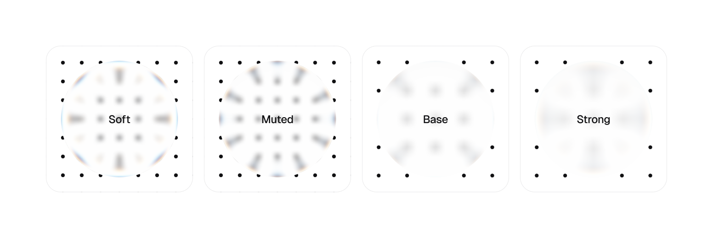
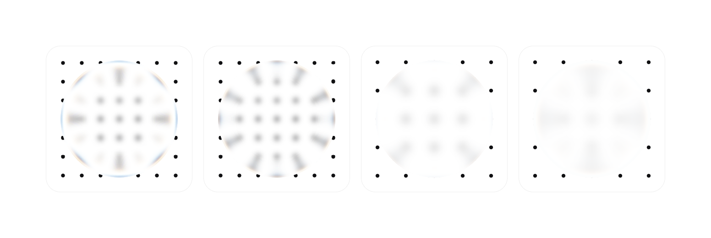

# Glass: принятый профиль края

Проверка 17–18 ноября 2026 после контура `b18a753`. Figma
`LuaiBd4anRi4DMZayKAnY2` только читалась. Runtime использует один профиль:
основание `0.4×depth`, показатель `2.8`, ширина сечения `0.72×depth`, степень
`2.7`. Длина луча ограничена `min(halfSize, depth) − inside`; в маленькой
фигуре depth сечения дополнительно ограничен шириной полосы. Авторские
frost/refraction/dispersion, их общий масштаб и порядок frost → lens сохранены.

Ограничение по depth убирает лишний цветной оборот в первой полосе. Оно выбрано
по четырём исходным Effects и проверено на отдельном Dock. Это приближение
закрытого renderer, не физическая теорема: API Figma определяет depth как
глубину эффекта, но не устанавливает максимальный боковой ход луча.
Независимое визуальное ревью предпочло этот вариант: у Soft вернулся синий
обод вместо коричневого, у Strong исчезло лишнее кольцо, объём сохранён.

Перед выбором исправлены два дефекта **диагностической композиции**:

- Жёсткий CSS radial-gradient давал зубчатые точки. SVG ellipse строится
  из `figma-glass-pattern.json` (`6236:41583`, 10×10, #101012), scale/spacing
  берутся из `figma-effects-scenes.json`. Без изменения runtime MAE четырёх
  панелей падает 2.432/3.036/1.612/1.672 → 1.966/2.275/1.434/1.540.
- В Dock alpha внутренней тени обрезалась перед blur после смещения.
  Явные filter/primitive bounds сохраняют её до последнего clip. Dock MAE
  1.344/2.214/2.337 → 1.203/1.226/1.222 при прежнем runtime. Белый Pegtop
  Soft Light остаётся только в этой диагностике; пакетный renderer не содержит
  общего перевода цветных Soft Light fills.

| Сцена | Прежний профиль, исправленная диагностика | Принятый профиль |
|---|---:|---:|
| Effects Soft | 1.966 | 1.742 |
| Effects Muted | 2.275 | 2.241 |
| Effects Base | 1.434 | 1.438 |
| Effects Strong | 1.540 | 1.478 |
| Dock центр | 1.203 | 1.171 |
| Dock правая | 1.226 | 1.227 |
| Dock левая | 1.222 | 1.223 |

MAE — RGB 0…255. Область прежняя: круг Effects с отступом 3px без надписи;
Dock — прежняя круговая область с отступом 2px. Эти средние пропускают самый
значимый край, поэтому `glass-edge-comparison.json` отдельно сохраняет полосы
по расстоянию от настоящего контура, signed RGB и максимальную ошибку.
Ошибка полосы 1–2px у Soft/Muted/Base/Strong падает соответственно
11.112/6.031/3.225/4.753 → **2.480/2.252/1.743/1.473**.

Остаток не скрыт: первые 0–0.5px Soft/Muted ухудшаются
5.715/5.050 → 8.800/7.396; синий край Soft ещё плотнее исходного. Кроме того,
родительские Effects имеют `BACKGROUND_BLUR=128` и `NOISE=.04 (#010205)`.
Диагностика воспроизводит PATTERN, но не этот noise; blur белого внешнего фона
нейтрален. Поэтому оставшиеся 1–2 RGB нельзя целиком приписывать линзе, и тонкая
подгонка по этой неполной композиции прекращена. Полное совпадение SURFACES
по этим изображениям не заявляется.




Полезные отрицательные опыты: глобальные refraction=0.85, paint-before-lens,
общая яркость и продолжение displacement за контур не приняты. Fan dispersion
0/0.04/0.08/0.12/0.16/0.24 оставил прежний коэффициент 0.08. У всех пяти Dock
Glass **dispersion=0**; цветные различия Dock этим параметром не объясняются.
Первый поиск общих параметров использовал 500 CPU-проб, затем настоящий
Chromium 140. CPU приближение отличается от браузера на 0.10–0.45 RGB;
малые улучшения по нему не принимались, глобальный оптимум не заявляется.

Таблица остаётся размером 1025 отсчётов, степени и корни не добавлены в
пиксельный цикл. Новая граница позволяет `lensReach=depth` и меньший атлас.
Все 174 Materials tests прошли; дополнительно расширено побайтовое сравнение
атласа и полного поля высотами 200/201px на новой границе переиспользования,
помимо Sheet 270/422/540/776. Build, typecheck и Biome прошли.
Golden hashes обновлены намеренно после визуального принятия.
Собранный production даёт PNG, побайтово равные независимо проверенному
прототипу и для Effects, и для Dock. [Независимая проверка](glass-independent-review.md)
фиксирует конкретную версию и собственные опыты движения.

Воспроизведение после build Materials, в полном headless Chromium:

```sh
GLASS_FROST_FACTORS=0.5 GLASS_REFRACTION_SCALES=1 GLASS_CALIBRATION_PREFIX=refined- node docs/evidence/materials-20261117/render-glass.mjs
DOCK_SMOOTH=1 DOCK_CONTOUR=1 DOCK_SOFT_LIGHT=pegtop DOCK_OUTPUT_SUFFIX=-refined pnpm --filter @labpics/ui-materials exec tsx ../../docs/evidence/materials-20261117/render-dock-holdout.mjs
pnpm --filter @labpics/ui-materials exec tsx ../../docs/evidence/materials-20261117/compare-glass-edges.mjs
```

SVG pattern и полные bounds включены по умолчанию. `GLASS_PATTERN=gradient`
и `DOCK_INNER_BOUNDS=0` оставлены только для воспроизведения старой диагностики.
Исходные данные и обе стадии сравнения сохраняются рядом с этим документом.

Основания: [Figma GlassEffect](https://developers.figma.com/docs/plugins/api/Effect/#glasseffect),
[преломление по нормали](https://kube.io/blog/liquid-glass-css-svg/),
[CSS shadow shape](https://www.w3.org/TR/css-backgrounds-3/#shadow-shape).
