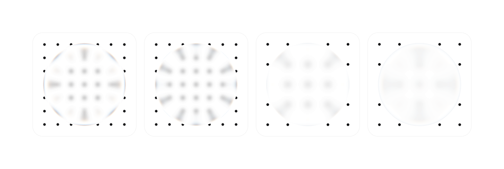

# Glass: геометрия и проверка изображения

Исходная Figma не изменялась. Сравнение использует четыре панели Effects
`7094:3307` из сохранённого PNG. Нулевая заливка этих панелей изолирует оптику.

Прежняя линза сдвигала каждый пиксель к центру на `0.15 × falloff`, поэтому
даже прямой край длинного Sheet тянул фон по диагонали. Теперь направление
задаёт нормаль ближайшего края, включая четыре разных угла и сглаживание Figma.
Глубина задаёт выпуклое сечение, а смещение получено преломлением вертикального
луча по Снеллиусу. У маленького контрола сечение ограничено его размером.
Обе ветки renderer ограничивают длину луча одинаково: половина меньшего размера
минус расстояние до края. Это консервативная граница толщины, не утверждение
о медиальной оси асимметричной фигуры. Прежнее ограничение через центр bbox
давало ложную полосу внутри большого эллиптического угла; independent review
выявило её; исправление проверено отдельным регрессионным тестом. Изменение
одного радиуса на 0.0001px больше не меняет
модель при переходе между общей и симметричной ветками.

Для web принята общая для всех уровней калибровка: ширина сечения `0.72×depth`,
основание `0.6×depth`, показатель `2.2`, степень суперэллипса `2.7`.
Это параметры приближения renderer, не новые авторские значения. Они выбраны
совместно по четырём панелям; физическая формула сама по себе не доказывает
тождественность закрытому renderer Figma. Frost остаётся `radius/2` перед линзой:
обратный порядок в совместном опыте был хуже на трёх панелях из четырёх.

| Figma панель / CSS tier | До, MAE | После, MAE |
|---|---:|---:|
| Soft / subtle | 5.952 | 2.432 |
| Muted / soft | 5.356 | 3.036 |
| Base / base | 2.149 | 1.612 |
| Strong / elevated | 3.450 | 1.672 |

MAE — средняя ошибка 8-битных RGB-каналов внутри круга радиусом 125px,
без центральной надписи. Сохраняются исходные `glass-calibration.json` и
`web-glass-frost-0.5.png`; новые — `snell-*`. Сравнивать нужно и PNG в масштабе
100%, особенно внешнюю полосу и цветной край. Перестановка R/B увеличивала
ошибку на всех четырёх панелях и не принята.

Профиль хранится в одной таблице на 1025 значений (около 8 KiB). Степени и
корни не выполняются в цикле по пикселям. Дистанции и нормали зависят только
от геометрии; refraction/dispersion меняют масштаб готового фильтра, transform
не пересчитывает карту. Для обычной симметричной формы сохранена четверть
поля; общий путь пропускает прозрачную середину. Ellipse solver вызывается
только в настоящих угловых областях, не для каждой прямой стороны.

`snell-field-benchmark.json` сравнивает полный старый исходник `f4326ca` с новой
моделью на том же Node 24.15/i9-12900K, Windows x64. 360×220@2, warm depth update:
Card 0.478→0.595 ms, Sheet 2.125→1.931 ms, ellipse 1.955→1.882 ms.
Новая геометрия после прогрева JIT: 2.270/8.648/9.585 ms соответственно.
Это CPU-карта, без encode/decode/raster; результат не является обещанием
кадровой частоты всей сцены.

Остаются различия внешнего края, направленного блика и дисперсии. Эти четыре
панели участвовали в подборе; независимой визуальной проверки других фигур
они не заменяют. Полный SURFACES этими числами не закрывается.

Отдельный неизменённый Floating Dock `7671:9049` сохранён в
`figma-dock-holdout.json/png`. Дополнительное чтение 17 ноября 2026 года
(`figma-dock-details.json`) установило `cornerSmoothing=0.6` у всех пяти Glass
фигур и подложки. Одних circular CSS border-radius для этой геометрии недостаточно.
В том же файле сохранены настоящие vector paths, цвет и opacity исходного
20×20 PATTERN `7533:5663`; его не нужно восстанавливать по пикселям скриншота.
Сглаженный контур перенесён в общий runtime; [проверка Dock](dock-optics.md)
отделяет его эффект от белого Soft Light и фиксирует оставшееся различие края.

Воспроизведение: собрать Materials, задать `GLASS_CALIBRATION_PREFIX=snell-`
и запустить `node docs/evidence/materials-20261117/render-glass.mjs` в полном
Chromium (`channel: chromium`). Обычный Headless Shell даёт другие пиксели.

Прочитанные основания:
- [Figma GlassEffect](https://developers.figma.com/docs/plugins/api/Effect/#glasseffect)
  и [исходные typings](https://github.com/figma/plugin-typings/blob/master/plugin-api.d.ts).
- [Модель преломления по нормали и SVG](https://kube.io/blog/liquid-glass-css-svg/).
  Масштаб SVG проверяется по используемому кодом правилу `scale×(channel−0.5)`;
  изложение диапазона scale в статье не используется как численный контракт.
- [Правило нормализации CSS-радиусов](https://www.w3.org/TR/css-backgrounds-3/#corner-overlap).

# Progressive: порядок собственного paint

Strong `6236:41501` имеет эффект, собственный PATTERN и дочерний эффект
`6236:41502`. Порядок — blur/noise → paint → blur/noise. Слот
`[data-veil-paint]` сохраняет именно его; без слота два эффекта захватывают
один внешний backdrop, как прежде. Слот не копируется и переживает resize,
смену профиля и снятие эффектов при повышенном контрасте.

`render-progressive.mjs` воспроизводит собственный paint между двумя проходами.
В `web-progressive-ordered.png` Strong приблизился к Figma: interior RGB MAE
2.974→1.530. Оба прохода остаются (10 полос и два noise-слоя); размытие не
сокращалось до одного ради производительности. Ghost/Soft остаются 2.054/2.182.
Различие AA исходных 1px-линий и конечное число полос ещё видимы.

Для изменяемой длины оси `--lab-veil-axis-length` переводит те же узкие полосы
в CSS calc. Начальная геометрия, физический blur, feather и порядок проходов
сохранены; размер больше не пересоздаёт DOM. `render-fluid-veil.mjs` сравнивает
реальный Chromium на четырёх направлениях и длинах 68/422/804: max 1 RGB byte,
MAE ≤ 0.021 (`fluid-veil-pixels.json`). Это сравнение двух реализаций того же
профиля, не новая калибровка Figma. Во всех трёх браузерах проверены возвращение
к прежнему размеру, сохранение узлов, нулевые чтения профиля и мутации полос
на 20 кадрах движения; изменение цветовой роли по-прежнему обновляет paint.

# Граница локальной браузерной проверки

`probe-backdrop-support.mjs` обнаружил ограничение Playwright screenshots
Firefox/WebKit: computedStyle принимает даже простые `blur(10px)`,
`brightness(2)`, `invert(1)`, однако PNG остаётся исходным backdrop. Chromium
действительно меняет пиксели. Это воспроизведено на Windows и hosted Linux/macOS
([run44038483973](https://github.com/Labpics-Team/labui/actions/runs/44038483973));
полные матрицы — `backdrop-support-{win32,linux,darwin}.json`.

Поэтому отрицательные CSS-capture опыты Firefox/WebKit из `render-check.md`
не доказывают невозможность метода в реальном Firefox/Safari. Пройденные
локальные lifecycle-проверки подтверждают состояние, порядок и освобождение;
они не подтверждают оптическую точность compositor этих двух браузеров.
[Upstream43646](https://github.com/microsoft/playwright/issues/43646) связывает
это в Firefox с `drawSnapshot`, который не снимает WebRender backdrop;
[Mozilla1657997](https://bugzilla.mozilla.org/show_bug.cgi?id=1657997) описывает
ограничение. Это свидетельство дефекта screenshot path, не отсутствия эффекта
на экране. `MATERIAL_CAPTURE=display` читает Xvfb framebuffer на Linux или
`screencapture` на macOS. Маркер страницы определяет начало и масштаб без
жёстких смещений browser chrome. Chromium screenshot и CPU-калибровка выше
не имеют наблюдаемого пропуска backdrop.

В actual-display опыте Firefox на Linux и macOS действительно рисует blur и
neutral paint-композицию через две соседние поверхности; расхождение с формулой
не превышает 2 единиц RGB. Данные — `backdrop-display-{linux,darwin}.json`.
В WebKit macOS простые filters работают, но положительный `brightness` перед
`opacity` не ограничивает промежуточное значение единицей: ошибка bright-overlay
до 25, dodge до 66 единиц. Dark-overlay с `invert` даёт ошибку до 1. Пара
`invert(1)` не меняет результат. Промежуточный `blur(.01px)` перед opacity
даёт bright-overlay с ошибкой до 2; обычная element opacity сохраняет ошибку 26.
Native `mix-blend-mode` в isolated capture работает в macOS WebKit (до 1),
но Chromium/Firefox дают ошибку до 115: изолированная группа не содержит
отфильтрованный внешний backdrop. Эти исходы сохранены в display JSON из
[run44052641877](https://github.com/Labpics-Team/labui/actions/runs/44052641877).
Следующий [production-срез paints](paint-renderers.md) заменил этот fallback,
сохранив ограничение пространственного grain в Gecko. Linux WebKit в Xvfb пока
не даёт полезного accelerated backdrop и не служит визуальным эталоном Safari.
