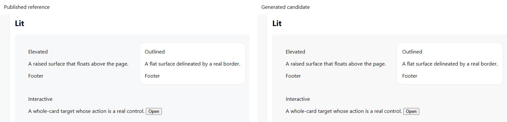

# Точность цвета

Авторские краски, белый текст на акценте и основная заливка сохраняют точные
значения [публичного эталона Lab UI v2.1](https://www.figma.com/community/file/1527814209910933331/lab-ui-components-icons-guides-lab-ui-v2-1).
`figma-reference.css` остаётся независимым неизменённым источником сравнения.
Отдельные законы свечения и shimmer описаны в [FX.md](FX.md).

## Принятый вычисляемый светлый тон

1 ноября 2026 года принято одно малое различие обычной Light-темы:
вычисляемый `--lab-bg-tone-2` даёт `rgb(248 248 249)`, тогда как в эталоне
соответствующий фон равен `rgb(247 248 250)`. Обе краски непрозрачны.
Один тон используется тремя прямыми алиасами:

- `--lab-bg-secondary`;
- `--lab-bg-grouped-primary`;
- `--lab-bg-grouped-tertiary`.

Решение принято после независимого сравнения реальных Card и открытого Select,
а также grouped-композиции с настоящими Card. Для grouped-ролей это тестовая
композиция: готовых продуктовых потребителей этих двух ролей при проверке не было.
Сохранены характер светлых поверхностей и их иерархия. Геометрия, содержимое,
состояние и фокус в каждой паре одинаковы; обратная замена восстановила исходный PNG.

Область визуального принятия — непрозрачные светлые поверхности в Chromium
140.0.7339.186 на Windows, профиль sRGB, DPR 1. Другие браузеры, материалы,
прозрачности и increased contrast этим сравнением не проверялись.

`test/golden-parity.test.mjs` отдельно фиксирует исходный RGB эталона, точный
принятый RGB и общий тон с ровно тремя алиасами. Остальные значения этого сравнения
продолжают сравниваться с эталоном точно. Общего допуска на различие RGB нет; источники,
alpha и вычисления генератора ради этого решения не менялись.
